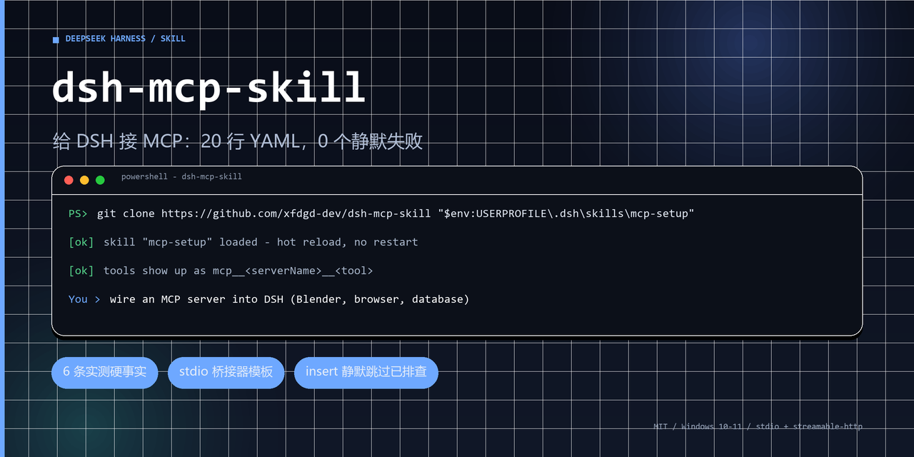

<p align="center">
  
</p>

<p align="center">
  <a href="LICENSE"></a>
  
  
  
  <a href="https://github.com/xfdgd-dev/dsh-mcp-skill/releases"></a>
</p>

<h3 align="center">给 DeepSeek Harness 接 MCP：20 行 YAML，0 个静默失败</h3>

<p align="center">让 DSH 直接调用外部工具——Blender、浏览器、数据库、自家后端的私有协议——不用每次从头踩坑。</p>

## 一行安装

```powershell
git clone https://github.com/xfdgd-dev/dsh-mcp-skill "$env:USERPROFILE\.dsh\skills\mcp-setup"
```

装完**不用重启 DSH**——skill provider 带文件监听，热加载。然后直接说：

> 装个 MCP 插件，把 Blender 接进来

## 30 秒判断要不要装

- 配置写进 `cordis.patch.yml` 了，工具却**不出现**，日志也不报错 → 大概率是下面那个 `insert` 坑。
- MCP server 在终端里跑得好好的，挂进 DSH 就**起不来** → 大概率是「启动即连后端」，被初始化探测搞死。
- 工具出来了，但中文参数**变乱码**、长任务**60 秒被砍** → 两个默认值问题，这里都写了怎么改。

反过来，如果你只想要一段能跑的配置，直接抄 [SKILL.md](SKILL.md) 里的模板就够，不必读完全文。

## 那个坑，值这 20 行

在 `cordis.patch.yml` 里顶层写 `- id: xxx / name: xxx / config: ...`，是「**按 id 覆盖已有插件**」的语义。

`id` 不存在时，代码只 `warn` 一句就 `continue`：**不报错、不生效、什么都不提示**。

新增插件必须包在 `- insert:` 里：

```yaml
- insert:
    - id: mcp-blender
      name: '@deepseek-ai/dsh-mcp-client'
      config:
        transport: stdio
        serverName: blender
        command: 'python'
        args: ['C:\path\to\bridge.py']
        toolCallTimeoutMs: 600000
```

这个结论不是从文档里抄的，是把 `app.asar` 解开、读 `applyEntryPatches()` 源码确认的。

## 里面有什么

```
SKILL.md                          # 主指令：6 条硬事实 + 四步流程 + 排错表
scripts/stdio_bridge_template.py  # stdio 桥接器骨架，改 2 个 TODO 就能用
scripts/asar_extract.py           # Electron app.asar 解包器（查 DSH 真实 schema 用）
install.ps1                       # 复制到 ~/.dsh/skills/mcp-setup
```

安装脚本有更细的用法：

```powershell
.\install.ps1 -Force                  # 覆盖已装的旧版本
.\install.ps1 -Target D:\other\skills # 换个 skill 目录
```

## 覆盖的核心知识点

| # | 事实 |
|---|---|
| 1 | 配置在 `<DSH_HOME>\profiles\<DSH_PROFILE>\cordis.patch.yml` |
| 2 | 新增插件**必须**包在 `- insert:` 里，否则静默跳过 |
| 3 | 插件名 `@deepseek-ai/dsh-mcp-client` 随 DSH 已装，不需要 npm install |
| 4 | `serverName` 必须匹配 `^[A-Za-z0-9_-]{1,32}$`，同一 Agent 内不能重复 |
| 5 | 保存后热重载，通常不用重启应用 |
| 6 | 工具名是 `mcp__<serverName>__<tool>` |

外加三个不在文档里的默认值：

- stdio 桥接器必须**延迟连接后端**——DSH 启动时会先起临时探测进程做 `initialize`，早连必炸。
- Windows 管道要**强制 UTF-8**（`PYTHONUTF8=1` + `PYTHONIOENCODING=utf-8`），否则中文参数变乱码。
- `toolCallTimeoutMs` 默认 **60000**，跑建模、渲染这类长任务记得调大。

## 适用环境

- Windows 10/11 上的 DSH 桌面版（路径、代码页相关的坑都按 Windows 写的）
- DSH 的 `stdio` 与 `streamable-http` 两种 transport
- 桥接器模板用 Python 3.9+，**仅标准库**，无第三方依赖

## 相关

- [dsh-solidworks-mcp](https://github.com/xfdgd-dev/dsh-solidworks-mcp) —— 同一套思路做出来的 SolidWorks COM 桥接器，可以当真实桥接器的完整例子看。

## License

MIT
